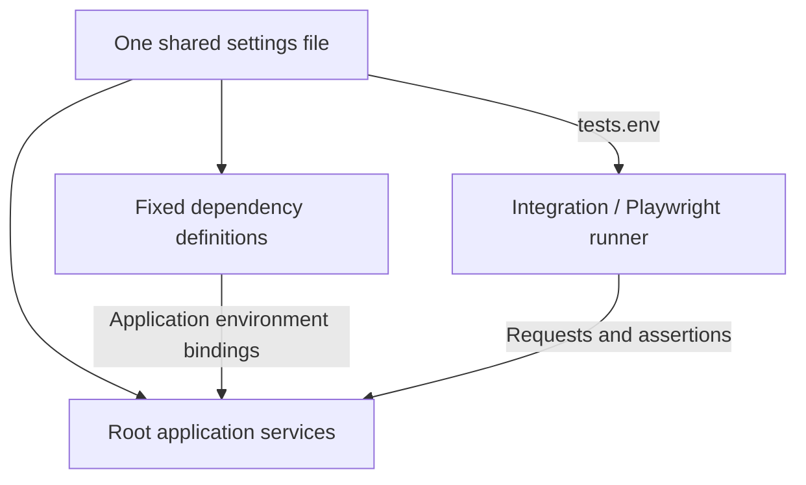

# Dependencies and worktrees

An application may use an isolated PostgreSQL database, a managed payment mock, shared
local search and a remote API together. Define that fixed topology once in the primary
checkout's `.redpact/settings.json`; all linked worktrees use it. Dependencies describe
integrated services, not npm packages installed by Docker builds.

| Kind | Provisioning and cleanup |
| --- | --- |
| `isolated` | Compose starts the declared dependency services for each execution |
| `mock` | Compose starts an implemented substitute, or bindings enable an in-process mock |
| `shared-local` | Existing host infrastructure; Redpact never starts or removes it |
| `remote` | Existing remote endpoint; Redpact never starts or removes it |

A kind does not install software or implement a mock. Declare only working connections.
Each dependency has one fixed definition; there are no selectable modes or recommendations.
The primary settings file supplies root services, dependency services and bindings.
Compose prerequisites extend that service set. Binding a variable does not start its target.

The declared relationships and environment bindings connect each consumer explicitly:

These declarations do not prove that a service is ready or that a test passed.

## Reading the overview

Open **Tools → Dependencies**, then select a diagram node to read its name, application/dependency type, configured
kind and authored description. Compose services remain collapsed with a count.
Used by and Uses show relationship counts and the other service's name and type;
relationship descriptions stay visible. Code evidence expands separately to show
complete paths and optional line numbers. These are authored source references,
not observed execution results. Empty relationships mean none were authored.

Application details place Used by and Uses side by side when the detail column has
at least 640px, and stack them on narrower screens within the shared 768px reading
width. The diagram and service details share one centered reading column with
matching widths and left edges. The configuration list uses the same shared
[reading-width policy](frontend.md#layout-and-reading-width), while text remains
left-aligned. Large diagrams scroll inside the column without shrinking their labels.
Dependencies show only Used by across the column. Nodes and disclosures
support keyboard activation; selecting a node does not move focus or execute code.
Missing descriptions are not inferred. Configuration and kinds do not establish
readiness, connectivity or approval.

## Shared configuration, independent execution

`rulesRoot` identifies the shared settings location. Compose, Dockerfile, app and test
paths resolve in the executing checkout, so a feature uses its own code. Each execution
owns fresh containers and networks; configuration sharing does not permit environment
reuse. Worktree selection files and dependency overlays do not affect execution.

Validate with `configure` using the actual checkout. Validation does not start services,
prove connectivity or grant approval. Execution captures settings, prepares resources,
checks readiness, runs tests and removes only its owned resources. Independently operated
shared-local and remote services remain alive; tests must isolate their fixture data.

Application bindings and the common runner environment are explicit and separate. Both
Integration and Playwright receive `tests.env` and the same connection-file format.
See [configuration](configuration.md) for declarations and [runner connectivity](execution.md#runner-connectivity)
for DNS, shared-host reachability and browser origins.

## Ask your agent

> Inspect the application's database, cache and external API connections. Configure one
> fixed Redpact topology shared by all worktrees. Verify each connection from its actual
> consumer and distinguish configuration validation from runtime evidence.

Continue with [project setup](first-project.md) or [review your first change](review-workflow.md).
