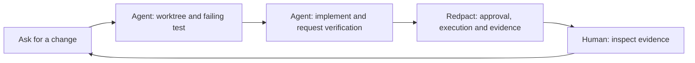

# Develop in chat, review with Redpact

Redpact connects a coding conversation to managed verification and human review.
Ask the agent to implement a change in an isolated worktree, write a failing test,
and record the checks against the actual application. Open Redpact when you need to
approve execution, inspect a failure or judge the recorded screens and source.

## One conversation, shared evidence

The host agent edits code and settings and performs Git operations. Redpact runs
Unit, Integration and Playwright checks, records what actually happened and links
the conversation to the same evidence in its viewer. Subagents can divide the work;
the coordinating agent still verifies their combined result in the intended checkout.

A local failing assertion supports the TDD cycle. A registered request, a parsed test
or a failed environment setup does not prove that assertion ran. Keep the observed
red and green evidence distinct from the user's acceptance of the change.

## What belongs where

| Surface | Responsibility |
| --- | --- |
| Chat and MCP | Inspect checkout status, diagnose configuration, request and cancel execution, retrieve evidence and explain remaining work |
| Redpact viewer | Current work, execution history, specific run evidence and resource problems |
| Approval card | Human decision about the captured execution request |
| Host agent and editor | Worktrees, file edits, diffs, commits, pull requests and merges |

The default viewer is a review workspace. Generic file browsing, Git Graph and
independent workspace tabs are not part of that interface. Advanced test catalogs,
manual Container and configuration remain available when needed. See
[viewer navigation](ux-navigation.md) for the exact destinations.

## Ask for a verifiable change

> Implement order quantity editing in an isolated worktree. First observe a test
> fail for the requested behavior, then implement it. Use Redpact to run the relevant
> checks against this checkout, capture the desktop and mobile user states, and
> return the recorded evidence and anything that still needs my decision.

The agent begins with checkout status and the shared configuration. Tests execute
through the MCP entry matching their runtime; approval requests stay pending until
a human uses the supported App controls or the connected execution review. Review links refer to the same local
instance and execution. See [review your first change](review-workflow.md).

## Three independent facts

A passing result describes the assertions or command that ran. It does not establish
that current files match those inputs, or that a person accepted the change. Redpact
keeps execution outcome, source freshness and human acceptance separate. Unknown
freshness remains unknown; neither the agent nor a status badge may invent approval.

All worktrees share one fixed configuration, while each run owns fresh temporary
resources. Read [dependencies and worktrees](dependencies.md) to understand which
services are isolated and which external data remains shared.

Start with [installation](installation.md), [project setup](first-project.md) and
[your first execution](first-run.md). Use [results](results.md) to interpret evidence
and [test authoring](tests.md) to extend coverage. Redpact is pre-release; this site
describes the implementation and does not connect to local projects itself.
