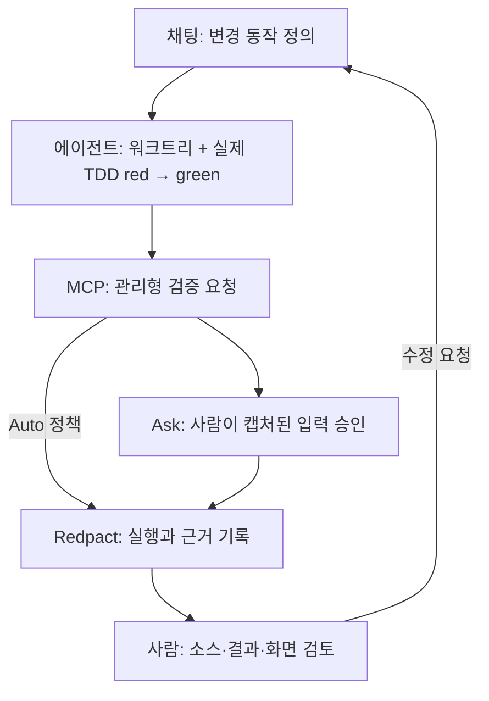

# 채팅에서 에이전트 변경 검토하기

[설치](installation.md)와 [프로젝트 설정](configuration.md)을 마친 뒤, 끝까지 실제
작업 체크아웃을 사용합니다. 이 예시의 주문 수량 변경은 올바른 입력의 새 합계를
저장하고 잘못된 입력에는 기존 주문을 유지합니다. 아래 내용은 수행할 절차이며,
이미 관찰된 실행 결과가 아닙니다.



## 1. 동작과 필요한 근거 요청하기

> 워크트리에서 TDD로 수량 편집을 구현해줘. 실제 앱의 공개 API로 정상 저장과 잘못된
> 입력 거부를 확인하고, 브라우저 조작도 검증해. 초기·저장·오류 상태를 데스크톱과
> 모바일에서 캡처해. Redpact를 사용하고 실제 실행 참조를 알려줘.

에이전트는 호스트 Git 도구로 워크트리를 찾거나 만들고, 절대 체크아웃 경로로
`redpact workspace status --path PATH`를 조회합니다. 공유 설정의 확인·검증이 필요하면 `redpact settings describe/get/patch/validate --scope project`를
사용합니다. 상태 조회만으로 테스트가 시작되지는 않습니다. 하위 에이전트는 명확한
파일 경계 안에서 API·UI·문서를 나눠 맡을 수 있으며, 총괄 에이전트가 통합된
체크아웃을 검증합니다.

## 2. 의도한 assertion 실패 관찰하기

구현 전에 수용 회귀 테스트를 작성하고 실행합니다. 어떤 assertion이 왜 실패했는지
기록합니다. 문법 오류, 사용할 수 없는 컨테이너, 누락된 의존성, 수집 오류는 환경
문제이며 기능적 red가 아닙니다. 의도한 assertion을 약화하지 않고 구현한 뒤 green을
확인합니다.

로컬 테스트 명령은 빠른 반복에 활용할 수 있지만 연결된 Redpact 기록을 만들지는
않습니다. 최종 근거는 관리형 실행으로 남기고 로컬에서만 관찰한 red·green은 분명히
밝힙니다. 런타임 세부사항은 [테스트 작성](tests.md)을 참고하세요.

## 3. 대화에서 관리형 검증 요청하기

| 근거 | MCP 진입점 |
| --- | --- |
| 설정된 Unit 전체 명령 | `redpact tests run --kind unit` |
| 공개 API와 저장 동작 시나리오 | `redpact tests run --kind integration` |
| 실제 브라우저 조작 | functional target을 지정한 `redpact tests run --kind playwright --target TARGET` |
| 기록된 애플리케이션 화면 | capture target을 지정한 `redpact tests run --kind playwright --target TARGET` |

각 요청은 정확한 워크트리 경로와 공유 고정 설정을 사용합니다. Unit, Integration,
Playwright의 런타임과 근거 계약은 서로 다릅니다. Ask 정책에서는 연결된 실행 검토 화면에서 사람이 실행을 승인해야 합니다. 에이전트는 대기 요청을 설명할 수 있지만 대신
승인하거나 정책을 바꿔 진행할 수 없습니다. 승인은 검토한 입력에 연결되며 결과 코드의
수락을 뜻하지 않습니다. 실행 허용 조건과 클라이언트 요구사항은
[인터페이스](interfaces.md)를 참고하세요.

## 4. 주의가 필요한 근거 열기

에이전트는 진행·종료 상태를 읽고 `redpact runs context --kind integration --id ID`로 제한된 실패 정보와 근거
참조를 얻어 같은 뷰어 인스턴스의 정확한 실행을 연결합니다. 그 실행에서 결과,
캡처된 소스, 로그와 스크린샷을 확인하세요. 이력은 기록된 워크트리에 묶입니다. 전체 앱에는 프로젝트·워크트리 탐색, 테스트 카탈로그, 환경·설정도 있습니다. 채팅 MCP는 구조화된 근거와 검토 링크를 반환합니다.

이름뿐 아니라 assertion을 읽어야 합니다. “합계 갱신”이라는 테스트가 상태 200만
확인한다면 저장을 증명하지 못합니다. 케이스·단계 결과와 캡처된 소스를 함께 확인하세요.
Unit은 전체 명령 출력을 기록하며 케이스별 사실을 만들어내지 않습니다. 스크린샷은
사람의 시각적 판단을 돕고, 캡처 성공만으로 승인된 것은 아닙니다.

## 5. 원래 근거를 보존하며 수정 요청하기

> 이 실행에서는 저장 후 새로고침하니 값이 돌아왔어. 기록된 소스와 실패 assertion을
> 확인하고 저장 동작을 고친 뒤 이 워크트리에서 같은 의도의 검증을 다시 실행해줘.
> 두 실행 ID와 정리 상태를 함께 알려줘.

새 실행은 새 입력을 캡처합니다. 과거의 통과 결과가 새 코드의 근거가 되지는 않습니다.
실행 결과, 현재 소스 최신성, 사람의 수락을 별도로 확인하세요. 리소스를 정리해도
기록된 근거는 보존됩니다.

호스트 에이전트가 요청 범위에 맞춰 커밋·PR·머지를 처리합니다. Redpact의 실행 승인은
이 작업들을 승인하거나 코드 검토를 대체하지 않습니다. 근거 종류별 해석은
[결과 읽기](results.md)를 참고하세요.

## 포함된 시나리오 실행하기

Docker와 연결된 런타임에서 `examples/order-desk`의 절대 경로를 사용합니다.
`redpact settings describe --scope project` 다음 `redpact settings validate --scope project`를 호출하고 제공된 고정
`app` / `payments: mock` 설정을 보존하세요. 다음 입력으로 `redpact tests run --kind integration`를 제출합니다.

```sh
redpact tests run --kind integration \
  --path /absolute/path/to/redpact/examples/order-desk --test http.test.js --json
```

테스트 경로는 예제에 설정된 `tests` 디렉터리 기준입니다. 시나리오는 HTTP 200과
`quantity: 1`, `totalCents: 250`을 포함한 응답을 검증합니다. 로컬 fixture가 관리형
서비스 연결을 제공합니다. 이 검증은 모의 결제 주문 응답 하나를 다루며 실제 제공자
호환성, 재시작 후 영속성이나 브라우저 동작을 증명하지 않습니다.
반환된 식별을 `redpact runs show --kind integration --id ID`으로 따라가며 필요한 사람의 승인을 거치고,
`redpact runs context --kind integration --id ID`로 정확한 결과를 여세요. ID·체크아웃·캡처 소스·결과·정리를
비교합니다. ID를 받았다는 사실은 통과가 아닙니다.

예제는 `REDPACT_URL=http://127.0.0.1:54318 node examples/order-desk/tools/review.mjs http`도
지원합니다. 각 실행은 새 환경을 소유합니다. 실패한 시도를 남기고 입력 수정 후 새
요청을 제출하세요. 조회는 재실행하거나 나중에 수정된 파일을 캡처하지 않습니다.
