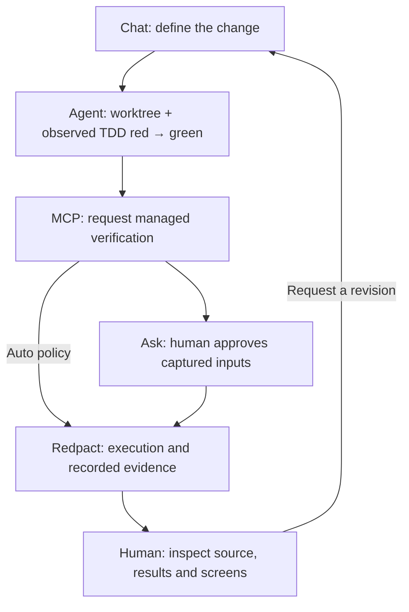

# Review an agent change from chat

Complete [installation](installation.md) and [project setup](configuration.md), then
use the actual working checkout throughout. This example concerns order quantity:
a valid change persists a new total; invalid input preserves the existing order.
It describes a workflow to perform, not previously observed execution results.



## 1. State the behavior and evidence

> Implement quantity editing in a worktree using TDD. Verify valid persistence and
> invalid-input rejection through the application's public API, check the browser
> interaction, and capture the initial, saved and error states on desktop and mobile.
> Use Redpact and return the actual execution references.

The agent resolves or creates the worktree with host Git tools and reads
`get_workspace_status` for that absolute checkout. It uses `configure` when shared
settings need inspection or validation. Status inspection never starts tests.
Independent subagents can own API, UI and documentation work with explicit file
boundaries; their coordinator verifies the integrated checkout.

## 2. Observe the intended assertion fail

Write the acceptance regression before implementation and run it. Record which
assertion failed and why. A syntax error, unavailable container, missing dependency
or collection failure is a setup problem, not functional red. Then implement the
change without weakening the intended assertion and rerun it to green.

Local test commands support fast iteration. They do not create connected Redpact
records. Use managed execution for the final evidence and identify local-only red
or green observations honestly. [Test authoring](tests.md) owns runtime details.

## 3. Request managed verification in the conversation

| Evidence | MCP entry |
| --- | --- |
| Complete configured Unit command | `run_unit_tests` |
| Public API and persistence scenarios | `run_tests` |
| Actual browser interactions | `run_playwright` with a functional target |
| Recorded application screens | `run_playwright` with a capture target |

Each request uses the exact worktree path and shared fixed configuration. Unit,
Integration and Playwright remain distinct runtimes and evidence contracts.
Under Ask, a human approves through the supported App card or connected execution
review. The agent may
explain or cancel the request; it cannot approve it or change policy to continue.
Approval is tied to the reviewed inputs and does not accept the resulting code.
See [interfaces](interfaces.md) for admission and client requirements.

## 4. Open the evidence that needs attention

The agent reads progress and terminal state, uses `get_review_context` for bounded
failure details and evidence references, and links the recorded execution in the same
viewer instance. Open that exact execution to inspect results, captured source,
logs and screenshots. Its history stays bound to the recorded worktree; the viewer
has no independent project selector or test-launch catalog.

Read the assertions, not just their titles. A test named “updates the total” that
only checks status 200 does not establish persistence. Compare case and step results
with captured source. Unit records whole-command output, not invented per-case facts.
Screenshots support human visual judgment; capture success alone is not approval.

## 5. Request a revision without losing the original evidence

> In this execution, the save succeeded but the value reverted after reload. Inspect
> the recorded source and failed assertion, fix persistence, and run the same intended
> check against this worktree again. Include both execution IDs and cleanup status.

A new run captures new inputs. Old passing results do not become evidence for new
code. Check execution outcome, current-source freshness and human acceptance
separately. Resource cleanup retains the recorded evidence.

The host agent handles commits, PRs and merges within the requested scope. Redpact's
execution approval does not authorize those actions or replace code review. Continue
with [reading results](results.md) to interpret each kind of evidence.

## Try the included scenario

With Docker and a connected runtime, use the absolute `examples/order-desk` path.
Call `configure describe`, then `configure validate`; preserve its supplied fixed
`app` / `payments: mock` settings. Submit `run_tests` with:

```json
{ "path": "/absolute/path/to/redpact/examples/order-desk", "tests": ["http.test.js"] }
```

The path is relative to that example's configured `tests` directory. The scenario
checks HTTP 200 and a response containing `quantity: 1` and `totalCents: 250`; its
local fixture supplies the managed service connection. This verifies one mocked
checkout response, not real-provider compatibility, restart persistence or browser behavior.
Follow the returned identity with `get_run`, including any human approval stages,
then use `get_review_context` to open the exact result. Compare the returned ID,
checkout, captured source, outcome and cleanup. An ID is not a passing result.

The example also supports `REDPACT_URL=http://127.0.0.1:54318 node examples/order-desk/tools/review.mjs http`.
Each execution owns a fresh environment. Preserve failed attempts and submit a new
request after fixing inputs; polling never reruns a request or captures later edits.
